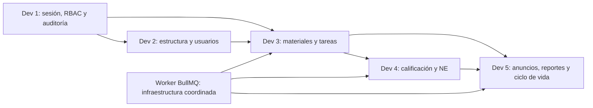

# 01 — Arquitectura propuesta, propiedad de los módulos y límites

## Stack obligatorio en la ERS (sección 6)

- TypeScript sobre Node.js 24 LTS.
- API NestJS; Prisma ORM; validaciones con Zod; Passport/Google OAuth 2.0 y credenciales locales de respaldo del administrador, argon2, otplib; `decimal.js` para calificaciones.
- Web Next.js; Tailwind CSS, shadcn/ui, TanStack, React Hook Form; `react-pdf` para visor, FullCalendar para calendario.
- MySQL 8.4, Redis + BullMQ, almacenamiento S3 compatible (MinIO local/R2 producción), ClamAV; Docker Compose, GitHub Actions.
- Pruebas Vitest y Playwright; observabilidad Pino, Sentry y Uptime Kuma.

## Estructura objetivo (propuesta para Dev 1)

```text
apps/
  api/src/modules/{auth,academic,users,contents,submissions,storage,grading,reports,notifications,...}
  api/src/common/{guards,interceptors,audit}
  web/app/{admin,curso,mis-notas,apoderado,...}
  worker/
packages/{shared,ui}
prisma/{schema,migrations,seed}
docker/
docs/
.github/workflows/
```

**No se debe crear una estructura contradictoria en ramas separadas.** Dev 1 aprueba scaffolding e interfaces base; Dev 3 propone los contratos y entidades que le corresponden.

## Diagrama de dependencias funcionales



## Límites de edición y de responsabilidad

- **Dev 1**: bootstrapping, sesiones, guards, bitácora, CI, UI compartida, estrategia de Docker y estándares.
- **Dev 2**: usuarios, roles almacenados, matriz año/período/grado/sección/curso-sección, matrículas; seeds académicos.
- **Dev 3**: materiales, tareas, versiones de entrega, almacenamiento seguro y coordinación del escaneo antivirus.
- **Dev 4**: notas, NE, exoneración, motor de promedio, conversión literal y panel de apoderado.
- **Dev 5**: anuncios, notificaciones, reportes, exportación, archivado y purga; coordina workers y colas.

**Frontera crítica:** Dev 3 informa que un PDF aprobado está disponible; Dev 4 es dueño de la calificación/NE. Una entrega tardía no debe sobrescribir por sí sola una nota: debe quedar disponible para recálculo/edición según reglas RN-05/06 y RF-45.

## Reglas de integración

- API con prefijo versionado `/api/v1`; contratos HTTP/JSON y DTOs documentados (PROPUESTA).
- Una única zona horaria institucional para la visualización de plazos (PROPUESTA: `America/Lima`); persistir marcas temporales en UTC y documentar conversión. **Requiere acuerdo.**
- Roles y pertenencia se comprueban SIEMPRE en servidor; acceso directo a PDF solo tras autorización y URLs firmadas cortas.
- Estado de tarea y entrega derivado de la fuente de verdad y con eventos idempotentes; no se duplican tablas de dominio.
- Tratar los datos de prueba como ficticios; prohibido subir credenciales, datos reales de menores y `.env` a Git.

## Sprints según plan

Sprint 0 base (1 semana); Sprint 1 núcleo; Sprint 2 flujo completo; Sprint 3 complementos; Sprint 4 cierre; Sprint 5 estabilización y E2E. Los sprints 1–4 se sugieren de 2 semanas, ajustables a la dedicación real.
