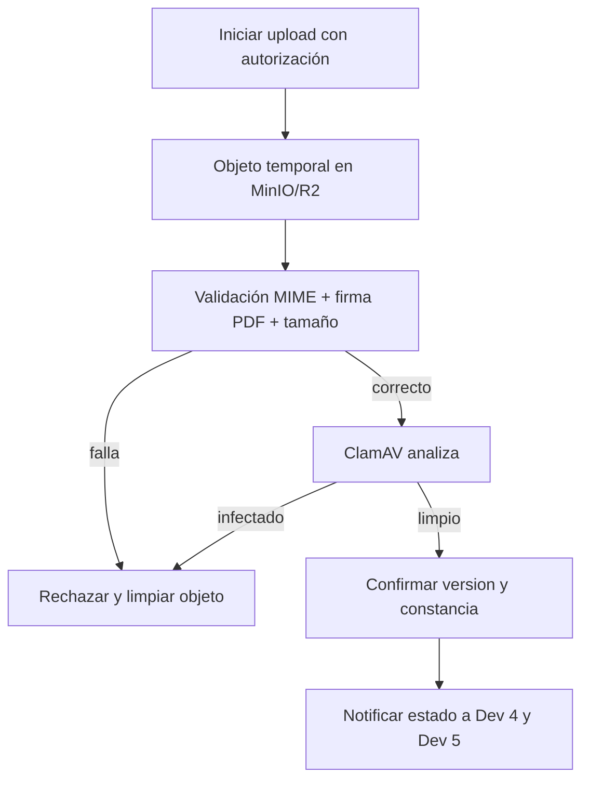

# 04 — Reglas de negocio, estados y escenarios límite

## Reglas textuales de la ERS (§4)

| Regla | Criterio que se debe preservar | Módulo principal |
|---|---|---|
| RN-01 | Nota numérica 0..20 | Dev 4 |
| RN-02 | Promedio simple, ninguna ponderación | Dev 4 |
| RN-03 | Redondear **una sola vez**, .5 hacia arriba, cálculo decimal exacto | Dev 4 |
| RN-04 | Tabla configurable; por defecto AD 18..20, A 14..17, B 11..13, C 0..10 | Dev 4/5 |
| RN-05 | Nota NE por tarea, 0..20, predeterminada 0; cuenta en promedio | Dev 4, configuración Dev 3 |
| RN-06 | Tardía solo si tarea permite; sin descuento automático | Dev 3 y Dev 4 |
| RN-07 | Exoneración no cuenta en promedio | Dev 4 |
| RN-08 | Solo PDF; 20 MB predeterminado, máximo 50 MB | **Dev 3** |
| RN-09 | Reentrega antes del plazo; última versión oficial | **Dev 3** |
| RN-10 | Con período cerrado no crear/editar/calificar actividades | Dev 2, **Dev 3**, Dev 4 |
| RN-11 | Un año lectivo activo; otros solo lectura | Dev 2 y todos |
| RN-12 | Pertenencia de docente, estudiante, apoderado y admin | Dev 1 y todos |
| RN-13 | Baja lógica del usuario | Dev 2/1 |
| RN-14 | Notas, promedios, bitácora conservados; PDF purgados según regla | Dev 4/1/5 y Dev 3 |
| RN-15 | Promoción confirmada manualmente por admin | Dev 2 |

## Los seis estados **visibles** que exige RF-38

1. **Pendiente**; 2. **Entregada**; 3. **Entregada con retraso**; 4. **No entregada (NE)**; 5. **Calificada**; 6. **Exonerada**.

**Propuesta de implementación:** mantener por separado (a) validación del archivo/versión, (b) puntualidad `isLate`, y (c) evaluación `Grade.state` (`GRADED`/`NE`/`EXEMPT`). Construir `displayStatus` al consultar, con precedencia acordada. Esto evita perder que una entrega fue tardía luego de calificarla. Los seis rótulos de RF-38 se conservan en UI, sin asumir que la ERS exige una sola columna enum.

| Situación | Propuesta de `displayStatus` |
|---|---|
| No hay versión aprobada y no venció | Pendiente |
| No hay versión aprobada y Dev 4 registró NE | No entregada (NE) |
| Dev 4 marcó exoneración | Exonerada |
| Dev 4 registró nota | Calificada (mostrar distintivo 'con retraso' si corresponde) |
| Hay versión limpia aceptada a tiempo, sin nota | Entregada |
| Hay versión limpia aceptada tarde, sin nota | Entregada con retraso |

## Línea de tiempo de subida propuesta (necesita decisión de equipo)

**No afirmar entrega exitosa antes de tener archivo íntegro y seguro.** Considerar recibo de intento de subida pendiente (separado de constancia de entrega válida) cuando un escaneo se demora. El instante determinante de entrega en un proceso asincrónico está **PENDIENTE DE APROBACIÓN**.

## Escenarios que el equipo debe resolver

- **A:** PDF de 20 MB exactos, PDF de 20 MB +1 byte y tarea con límite 50 MB.
- **B:** usuario `.pdf` que contiene binario no PDF; `.exe` renombrado PDF; PDF corrupto o protegido.
- **C:** subido 23:58, antivirus termina 00:02; si había fecha límite 23:59, ¿qué marca de tiempo fija puntualidad?
- **D:** tarea permite tardías; hay NE asignada; llega PDF válido. RF-45 pide sustitución de NE por nota que asigne docente. Dev 3 NO modifica unilateralmente `Grade`.
- **E:** tarea NO permite tardías; se bloquea la subida después de vencimiento (RF-37).
- **F:** período académico cerrado; bloquear creación, edición y calificación, y precisar comportamiento de descargas y entregas tardías asociadas al período (a acordar).
- **G:** estudiante cambia de sección después de entregar; se conserva historial (RF-24).
- **H:** libro reutilizable sobrevive a purga; material común no reutilizable sigue regla de retención RF-66.
- **I:** mismo request duplicado por reintentos de red: idempotencia sin crear dos versiones.

## Historial de matrícula y vínculos de menores (PROPUESTA, 26/10/2026)

- **Baja de un usuario (RN-13):** se hace por `status` (`INACTIVE` o `WITHDRAWN`, D-021). No se borra el usuario ni sus matrículas.
- **Historial de matrícula (RN-14, RF-24):** las matrículas cerradas (traslado `TRANSFER`, retiro `WITHDRAWAL`, cierre de año `YEAR_END` o corrección `CORRECTION`) se conservan junto con sus notas. Un retiro o una baja no borra la matrícula: la cierra (`isCurrent` NULL, `effectiveTo` y `endReason`).
- **Vínculos apoderado–estudiante de menores:** `GuardianStudent` se conserva mientras existan los dos usuarios. Las FK son `Restrict`, así que no hay borrado en cascada. La revocación auditable ya está en F3 (PROPUESTA, abajo). **PENDIENTE INSTITUCIÓN:** finalidad y plazo de conservación de cada vínculo (D-032).

### Revocación de vínculos (RN-13, RN-14; PROPUESTA F3)

- Un vínculo vigente tiene `isActive` TRUE y `revokedAt` vacío. Revocarlo escribe `isActive` NULL y `revokedAt` (nunca FALSE). La fila se conserva con su historial.
- Solo puede haber un vínculo vigente por par apoderado–estudiante (UNIQUE con el marcador). Después de revocar se puede crear uno nuevo con otro `id`.
- El motivo de la revocación (10..500 caracteres) va solo a la bitácora (ver docs/03, advertencia sobre datos de menores).
- Un vínculo revocado no da acceso: `getLinkedStudentIds` lo excluye.

### Retiro, rematrícula y traslado de estudiantes (RF-18, RF-23, RF-24; PROPUESTA F3)

- **Retiro (`WITHDRAWN`).** En la misma transacción cierra las matrículas vigentes de los años no cerrados: `isCurrent` NULL, `effectiveTo` y `endReason` `WITHDRAWAL`. Las matrículas de años cerrados no se tocan. La bitácora registra cada cierre.
- **Retiro y vínculos.** El retiro no revoca los vínculos de apoderado. El apoderado deja de tener acceso porque `getLinkedStudentIds` excluye a los estudiantes `WITHDRAWN`. Si el estudiante vuelve a `ACTIVE`, el vínculo vuelve a contar. Así no se pierde historial, pero la decisión sobre cuánto tiempo se guarda el vínculo queda pendiente (D-032).
- **Inactivo.** `INACTIVE` no cierra matrículas ni quita vínculos; el estudiante sigue contando para el apoderado.
- **Rematrícula.** Tras un retiro, `WITHDRAWN` → `ACTIVE` no reabre la matrícula cerrada. Se matricula de nuevo con una matrícula nueva en una sección del año activo (`POST /students/:id/enrollments`). Un estudiante `WITHDRAWN` no se matricula, no se traslada y no se vincula.
- **Traslado (`TRANSFER`).** Mismo año y mismo grado; sección distinta. La matrícula vigente se cierra con `effectiveTo = at` y `endReason` `TRANSFER`, y se crea otra en la sección destino con `effectiveFrom = at`. Las fechas las fija el servidor: `at = max(ahora, effectiveFrom de la vigente)`. El historial se conserva (RN-14, G de la tabla de escenarios).

### Patrón de CHECK con marcadores TRUE/NULL (PROPUESTA F3)

En MySQL, un CHECK que evalúa a UNKNOWN **no falla**: una condición con `NULL` pasa en silencio. Por eso, en las columnas que valen TRUE o NULL (`AcademicYear.isActive`, `Enrollment.isCurrent`, `GuardianStudent.isActive`), la rama TRUE empieza con `<columna> IS NOT NULL AND <columna> = 1`. Así una fila con el marcador NULL y sin fechas o sin motivo no pasa por la rama TRUE.

- Hallazgo de la revisión de F3 (modelador-bd): `Enrollment_isCurrent_chk` (migración `academic_estructura`) aceptaba `isCurrent` NULL sin `effectiveTo` ni `endReason`. Se recreó en la migración `20261027000217_enrollment_iscurrent_check_fix`. En los datos del seed de desarrollo, 0 de 62 filas lo incumplían.
- `GuardianStudent_isActive_chk` sigue el mismo patrón desde su creación (migración `20261026235821_guardian_student_revocable`).
- Regla para cualquier CHECK nuevo sobre un marcador TRUE/NULL: escribirlo con `IS NOT NULL` en la rama TRUE y probarlo en un ROLLBACK con cierre sin fecha, sin motivo y con marcador FALSE.

## Alcance excluido (ERS §7)

No implementar asistencia, exámenes/cuestionarios, SIAGIE, integración Google Drive/Classroom, detección automática de entregas duplicadas ni ponderación de actividades.
